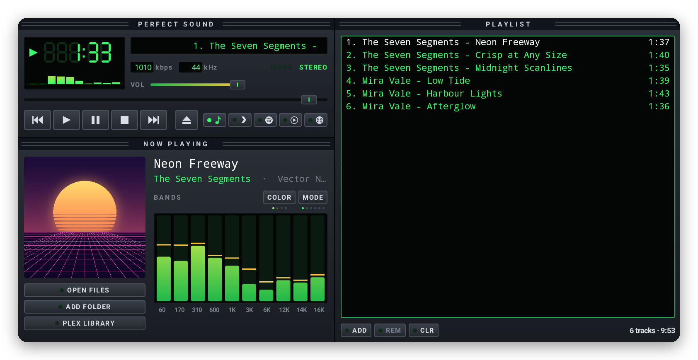
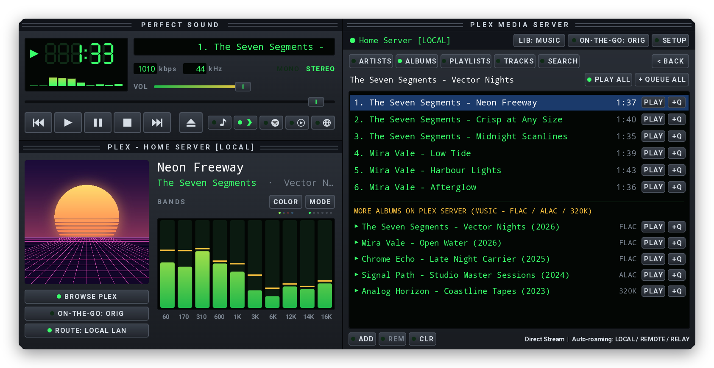
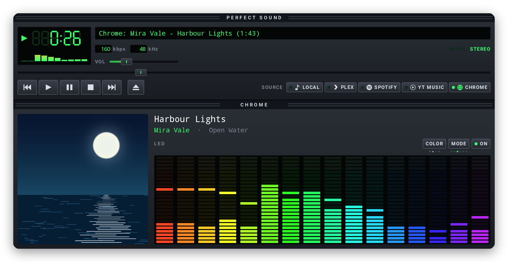

<p align="center">
  
</p>

<h1 align="center">Perfect Sound</h1>

<p align="center">
  <b>A music player for Googlebooks in the spirit of the classic '90s desktop players.</b><br>
  A seven-segment clock, a scrolling title, a live visualizer and a proper playlist, drawn crisp at
  any size. It plays your own files, streams from your <b>Plex Media Server</b> (at home or on the go),
  and can follow and control Spotify, YouTube Music or any Chrome tab.
</p>

<p align="center">
  <a href="../../releases/latest/download/PerfectSound.apk"><b>⬇ Download PerfectSound.apk</b></a>
  &nbsp;·&nbsp; <a href="#plex-media-server-home--on-the-go">Plex Streaming</a>
  &nbsp;·&nbsp; <a href="#install">Install</a>
  &nbsp;·&nbsp; <a href="#privacy">Privacy</a>
  &nbsp;·&nbsp; <a href="CHANGELOG.md">What's new</a>
  &nbsp;·&nbsp; <a href="#licenses">Licenses</a>
</p>

<p align="center">
  
  
  
  
  
</p>

<p align="center"><sub>Originally created by <a href="https://github.com/sanjaynathwani-blip">sanjaynathwani-blip</a> · Plex Media Server streaming (LAN / Remote / Relay) added by <a href="https://github.com/phshah">phshah</a>, proudly developed on a Googlebook.<br>
Not affiliated with or endorsed by any employer, or by Winamp, Plex, Spotify, YouTube or Google (<a href="#about-this-project--contributors">more</a>).</sub></p>

<p align="center">
  
</p>

## What it is

Perfect Sound is a free, open-source music player that brings back the feel of the desktop
players of the late '90s: a dark panel with an LCD clock, a title that scrolls, bars that bounce to
the music and a playlist you drive with the keyboard. It's built from scratch for Android with
Kotlin and Jetpack Compose, and everything is vector graphics, so it stays sharp at the
Googlebook's display scaling and at any window size.

- **Your own music:** MP3, FLAC, AAC, Ogg, Opus, WAV and more, with gapless playback, a media
  notification, lock-screen and media-key controls, and it picks up where you left off.
- **Plex Media Server streaming:** stream your personal music library directly from your Plex server
  with automatic **Local LAN**, **Remote Direct**, and **Plex Relay** roaming, plus **On-the-Go**
  bitrate control (`ORIG`, `320K`, `192K`, `128K`). Because Plex audio plays through Perfect Sound's
  built-in engine, the 10-band equalizer and all six visualizers work natively with zero extra permissions.
- **A visualizer** with six modes and four colour themes (below).
- **Remote mode** for the **Spotify** and **YouTube Music** web players and anything else in
  **Chrome**: see and control what's playing, with the visualizer bouncing to it too.
- **A real playlist:** add local files, folders, or Plex tracks/albums/playlists; select with Ctrl
  and Shift, drag to reorder, right-click for more.
- **The classic keyboard shortcuts:** Z X C V B for the transport, and the rest below.

## The visualizer

<p align="center">
  
  <br><sub>BANDS, SPECTRUM, LED, CURVE and SCOPE, in the green, ice, rainbow and red themes. A sixth mode, VU METER, draws a pair of tape-deck needle meters.</sub>
</p>

**MODE** cycles the six modes (or click the display) and **COLOR** cycles the themes; small dots
under each button show where you are, and Perfect Sound remembers both. For your own files and
**Plex** streams, the visualizer and 10-band equalizer need no special audio-capture permissions at all.

## Plex Media Server: Home & On the Go

<p align="center">
  
  <br><sub>Streaming from a Plex Media Server: the player on the left shows the active server and route (<code>PLEX - HOME SERVER [LOCAL]</code>), while the Plex Music Browser on the right browses artists, albums, playlists and tracks with one-click <code>PLAY</code> and <code>+Q</code> queueing.</sub>
</p>

Pick **PLEX** in the source bar (or click **PLEX LIBRARY** / **ADD → Add from Plex…**) to open the
retro LCD **Plex Music Browser**:

- **Two ways to connect:**
  - **Automatic Plex Sign-In (Recommended):** signs in via `plex.tv` (one-tap browser OAuth or
    4-character `plex.tv/link` code) to automatically discover all of your Plex servers and their
    local, remote, and relay endpoints.
  - **Manual Server URL + Token:** connect directly to any `https://host:32400` (plus an optional
    remote/DDNS URL) using your `X-Plex-Token`.
- **Works on the same network and on the go:**
  - Concurrent endpoint probing automatically selects the fastest reachable route:
    **`LOCAL`** (Direct LAN) → **`REMOTE`** (Port-forwarded / Direct Remote) → **`RELAY`** (Plex Relay fallback).
  - Live network-change monitoring (`ConnectivityManager.NetworkCallback`) seamlessly switches between
    home Wi-Fi and cellular/remote connections—even mid-playlist or when resuming a saved queue.
  - Supports TLS verification for `*.plex.direct` certificates over direct LAN IPv4 addresses on
    routers with DNS rebinding protection.
- **On-the-Go streaming quality (`ORIG` / `320K` / `192K` / `128K`):**
  - On **`LOCAL`** Wi-Fi/LAN, tracks always direct-stream in original lossless/source quality.
  - On **`REMOTE`** or **`RELAY`** connections, toggle **ON-THE-GO** between **`ORIG`** (direct stream)
    or **`320K` / `192K` / `128K`** to transcode on the fly via Plex's Universal Audio Transcoder.
- **Browse & queue:** browse **Artists**, **Albums**, **Playlists**, **All Tracks**, or **Search**
  across your music sections, and either **+ QUEUE** tracks into your mixed playlist or **▶ PLAY**
  immediately.

## Remote mode: Spotify, YouTube Music and Chrome

<p align="center">
  
  <br><sub>Following a Chrome tab: the title, artist, album art and position come from Chrome's media session. SPOTIFY and YT MUSIC work the same way for their web players.</sub>
</p>

Pick **SPOTIFY** or **YT MUSIC** next to the transport buttons and Perfect Sound opens that web
player in Chrome, or brings its tab back to the front; pick **CHROME** for anything else a tab
plays. Start something, and Perfect Sound shows and controls it: play, pause, skip, seek and the
volume. The audio stays in Chrome.

Why the web player rather than the Spotify app? The app marks its audio as off limits to other
apps, so the visualizer couldn't move to it.

The first time, Perfect Sound asks you to turn on **notification access**, Android's way of
letting an app see and control what other apps are playing. Because Perfect Sound is installed
from a download, Android may grey that switch out as a **restricted setting**. If it does, click
the switch and **OK**, then click **APP INFO** in Perfect Sound, open **⋮** at the top right and
choose **Allow restricted settings**. After that, **GRANT ACCESS** turns on as usual.

To make the visualizer bounce to them, press **ON** and pick **Chrome** when Android asks which
app's audio to share. It asks each time, and Perfect Sound only ever captures other apps' media
playback, never the microphone.

## Made for the Googlebook

- **A desktop window:** it resizes freely, and when there's room the playlist moves beside the
  player. The source buttons shrink to icons when the player is narrow.
- **Right-click menus** on the player and the playlist, **multi-select** with Ctrl and Shift,
  **drag to reorder**, and **drop files** from the Files app straight onto the window.
- **Open with Perfect Sound** from Files or Chrome's downloads.
- **Keyboard first:**

| Keys | Action |
| --- | --- |
| Z / X / C / V / B | Previous / Play / Pause / Stop / Next |
| Space | Pause / resume |
| ← / → | Seek 5 seconds |
| ↑ / ↓ | Volume (in the playlist: move the selection) |
| L / Shift+L | Open files / Add folder |
| S / R | Shuffle / Repeat |
| Alt+G / Alt+E | Show the visualizer / playlist |
| Enter / Delete / Ctrl+A | Play / Remove / Select all (in the playlist) |

## Install

Perfect Sound isn't in a store; you install the APK from this page. It takes a minute:

1. On your Googlebook (or any Android 10+ device), download
   **[PerfectSound.apk](../../releases/latest/download/PerfectSound.apk)**.
2. Open it: click the download in Chrome, or find **PerfectSound.apk** in the **Files** app under
   Downloads.
3. The first time, Android asks whether Chrome (or Files) may install apps: choose **Settings**,
   turn on **Allow from this source**, go back and click **Install**.
4. Open **Perfect Sound** from the launcher and click **OPEN FILES** or **ADD FOLDER**, pick
   **PLEX** to stream from your Plex server, or pick **SPOTIFY**, **YT MUSIC** or **CHROME**.

**Updating:** download the new PerfectSound.apk and install it over the old one; your playlist and
settings stay. Every release is signed with the same key, and Android refuses an update signed with
another, so only install Perfect Sound from this page.

**Checking the download** (optional): each release lists SHA-256 checksums in `SHA256SUMS`; in the
Googlebook's Linux Terminal, `sha256sum PerfectSound.apk` prints the one to compare.

## Privacy

- **No telemetry, analytics or ads.** Network access is used solely when you connect to your own
  **Plex Media Server** (and `plex.tv` if you choose automatic Plex discovery). Saved playlists store
  logical `plex://` track references on disk without embedding your `X-Plex-Token`.
- **Your files only through you.** It sees the local files and folders you pick or drop on it, and
  nothing else of your storage.
- Every runtime permission is optional and asked for only when you use the feature that needs it:

| Permission | Why |
| --- | --- |
| Internet & Network State | Used only to discover and stream audio/artwork from your Plex Media Server and detect network handoffs between LAN and remote connections |
| Notifications | The media controls while music plays in the background |
| Notification access | Android's way of letting an app see and control Chrome's media sessions. Perfect Sound also reads Chrome's media notification to see which site is playing (Spotify, YouTube Music or another); it reads no other notifications |
| Record audio, and the share prompt | Android's way of letting an app hear other apps' playback for the visualizer in remote mode. Only media playback is captured, never the microphone, and nothing is recorded or kept |

Uninstalling Perfect Sound removes everything it stored.

## To do

- [ ] **Screen readers:** label the drawn controls for TalkBack.
- [ ] **Ideas under consideration:** local media library browsing by artist and album, saved
  playlists, and lyrics.

Ideas and bug reports are welcome in [Issues](../../issues).

## How it's built

Perfect Sound is plain Android: Kotlin, Jetpack Compose for every pixel of the interface (the
seven-segment digits, the sliders and the meters are all drawn in code), and AndroidX Media3 for
playback and the media session. Plex streaming uses a Media3 `ResolvingDataSource` that resolves
logical `plex://` URIs at playback time against the best active server endpoint (`LOCAL`, `REMOTE`,
or `RELAY`). Remote mode uses Android's media sessions and notification-listener
API (Chrome's media notification names the site that's playing, which tells Spotify and YouTube
Music apart from other tabs); the remote visualizer uses `AudioPlaybackCapture`. The app lives in [`app/`](app/).

```sh
./gradlew assembleDebug          # app/build/outputs/apk/debug/PerfectSound-debug.apk ("Perfect Sound Dev")
./gradlew testDebugUnitTest      # unit tests
./gradlew assembleRelease        # signed only if ~/.config/perfect-sound/keystore.properties exists
```

It needs JDK 17 and the Android SDK (platform 36). The debug build installs next to the release
one, as **Perfect Sound Dev**. A [GitHub Actions workflow](.github/workflows/build.yml) builds it
and runs the unit tests on every push and pull request.

Releases are checked on a device the way users install them; see [RELEASING.md](RELEASING.md).

## Made on a Googlebook

Perfect Sound was made entirely on a Googlebook, in its built-in Linux Terminal:

- The Terminal's Debian VM runs Gradle and the Android SDK, building and signing the APK.
- The app goes straight onto the same laptop over Wireless debugging, where every change is tried
  for real and checked with `adb` screenshots.
- The music in these screenshots is made up and made by code: [`tools/demo_music.py`](tools/demo_music.py)
  synthesizes the tracks and paints their cover art, and
  [`tools/readme_images.py`](tools/readme_images.py) turns window captures into the images on this
  page. The logo is [`brand/perfect-sound-logo.svg`](brand/perfect-sound-logo.svg).

## About this project & Contributors

### Original Author — [sanjaynathwani-blip](https://github.com/sanjaynathwani-blip) (`v0.1.0` – `v0.4.3`)
Perfect Sound was created as a personal passion project by
[sanjaynathwani-blip](https://github.com/sanjaynathwani-blip), built from scratch on a Googlebook:
- Custom vector-drawn '90s desktop interface in Jetpack Compose (seven-segment LCD clock, marquee, bevelled controls, resizeable desktop layout, and keyboard shortcuts).
- Local file and folder playback via AndroidX Media3 with gapless playback, drag-and-drop playlist management, and persistent queue restoration.
- Built-in 10-band equalizer and six real-time visualizer modes (`BANDS`, `SPECTRUM`, `LED`, `CURVE`, `SCOPE`, `VU METER`) across four colour themes.
- Remote mode for following and controlling **Spotify**, **YouTube Music**, and **Chrome** web players via `MediaSessionManager` and `AudioPlaybackCapture`.

### Plex Media Server Integration — [phshah](https://github.com/phshah) (`v0.5.0`)
[phshah](https://github.com/phshah) extended Perfect Sound with native **Plex Media Server** audio streaming (`app/src/main/java/app/perfectsound/player/plex/`):
- **Plex OAuth & PIN Authentication:** browser OAuth (`strong=true`) and 4-character `plex.tv/link` PIN sign-in with automatic server discovery, plus manual server URL + `X-Plex-Token` support.
- **Seamless Home & On-the-Go Roaming:** concurrent endpoint probing (`LOCAL` LAN → `REMOTE` Direct → `RELAY` fallback), live `ConnectivityManager.NetworkCallback` handoff across Wi-Fi and cellular networks, and `*.plex.direct` TLS verification over direct LAN IPs.
- **On-the-Go Bitrate Control:** lossless direct streaming on local LAN and configurable remote transcoding (`ORIG`, `320K`, `192K`, `128K`) via Plex's Universal Audio Transcoder.
- **Retro LCD Plex Music Browser:** browse and search artists, albums, playlists, and tracks across Plex music libraries (`PlexBrowserDialog`), with Media3 `ResolvingDataSource` token-safe `plex://` queue persistence and authenticated cover art loading.

This project has no affiliation with any employer: no employer made, sponsored, reviewed or endorsed it, and nothing here speaks for any employer or endorses its products.

It's inspired by the desktop music players of the late '90s but shares no code or artwork with
any of them. Winamp is a trademark of its owners, Plex is a trademark of Plex, Inc., Spotify is a
trademark of Spotify AB, and Chrome, YouTube Music and Googlebook are trademarks of Google LLC;
they're named only to describe what Perfect Sound works with, and none of them made or endorsed it.

## Licenses

- **Perfect Sound's own code**, the logo, the tools and the demo music are under the
  [MIT License](LICENSE).
- The libraries built into the app (AndroidX Media3, Jetpack Compose, AndroidX, the Kotlin
  standard library, kotlinx.coroutines and Guava, and Square OkHttp) are under the **Apache License 2.0**.

[`THIRD_PARTY_NOTICES.md`](THIRD_PARTY_NOTICES.md) lists every component inside the app, and
[`licenses/`](licenses/) holds the license text.
